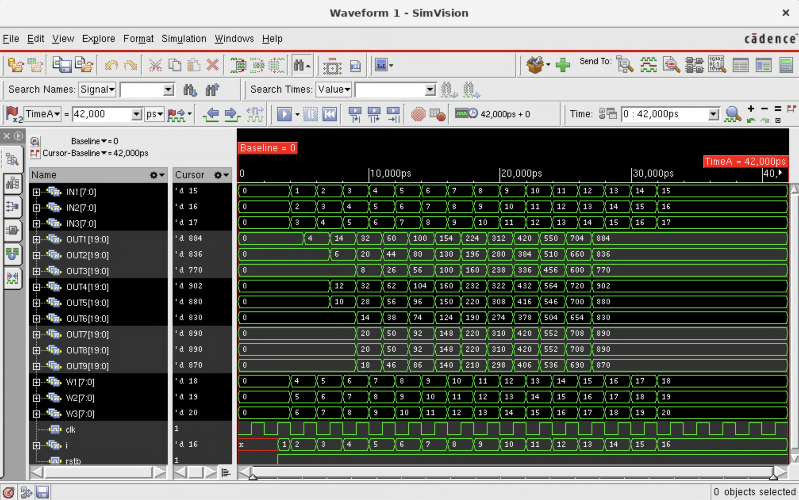
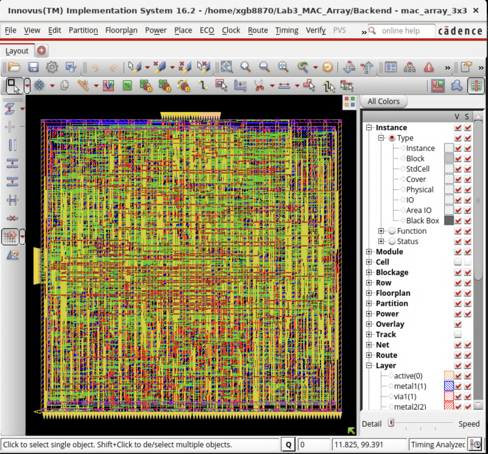
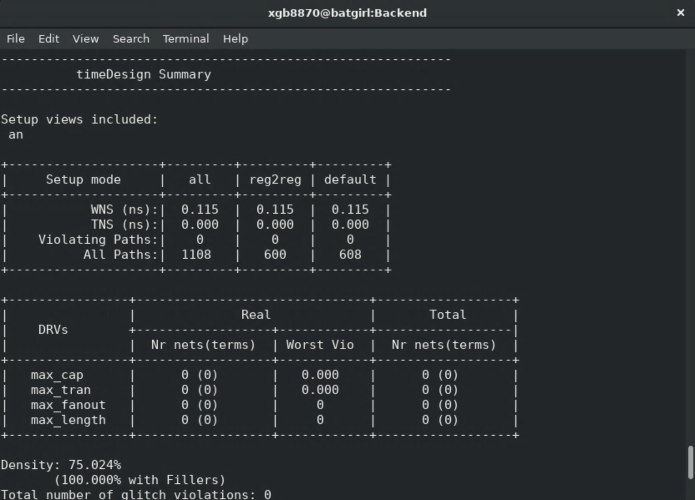
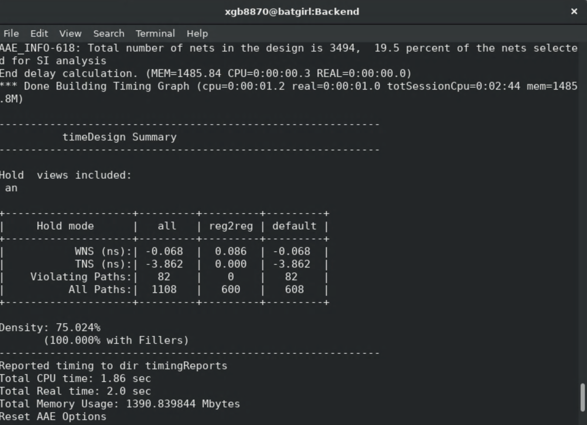

# 3x3MAC

**Comp Eng 303 Lab 3 — Emmett Funston**

A 3 × 3 signed multiply-accumulate (MAC) array, with the Verilog RTL, testbench, timing constraints, and implementation results from the lab report.

**[Read the complete lab report (PDF)](report/CompEng303_Lab3.pdf)**

## Design

The array accepts three signed 8-bit inputs and three signed 8-bit weights. Delayed input and weight registers align the nine MAC operations, which accumulate into signed 20-bit outputs. The report's RTL accumulates for 13 clock cycles after reset.

| File | Contents |
| --- | --- |
| [`rtl/mac_array_3x3.v`](rtl/mac_array_3x3.v) | 3 × 3 MAC array RTL |
| [`rtl/mac_array_3x3_tb.v`](rtl/mac_array_3x3_tb.v) | Simulation testbench from the report |
| [`constraints/mac_array_3x3.sdc`](constraints/mac_array_3x3.sdc) | 2 ns clock and input/output delay constraints |
| [`report/CompEng303_Lab3.pdf`](report/CompEng303_Lab3.pdf) | Original, complete 10-page report |

## Results from the report

| Check | Reported result |
| --- | ---: |
| Setup worst negative slack | +0.115 ns; 0 violating paths |
| Hold worst negative slack | −0.068 ns; 82 violating paths |
| Cell area | 5,827.262 µm² |
| DRC, connectivity, and antenna checks | 0 violations reported |

The report states that the gate-level waveform matches the RTL waveform. The hold result above is a reported timing violation; the screenshots are preserved below for context.

## Lab images

| Simulation | Physical layout |
| --- | --- |
|  |  |

| Setup timing | Hold timing |
| --- | --- |
|  |  |

Additional screenshots: [connectivity and area](images/connectivity-and-area.png) · [DRC](images/drc.png) · [connectivity](images/connectivity.png) · [power](images/power.png).

## Run the included testbench

With Icarus Verilog installed:

```sh
iverilog -o mac_array_3x3_tb rtl/mac_array_3x3.v rtl/mac_array_3x3_tb.v
vvp mac_array_3x3_tb
```

The source and screenshots were transcribed or extracted from the PDF. The simulation and physical implementation results shown here are those recorded in the report.
